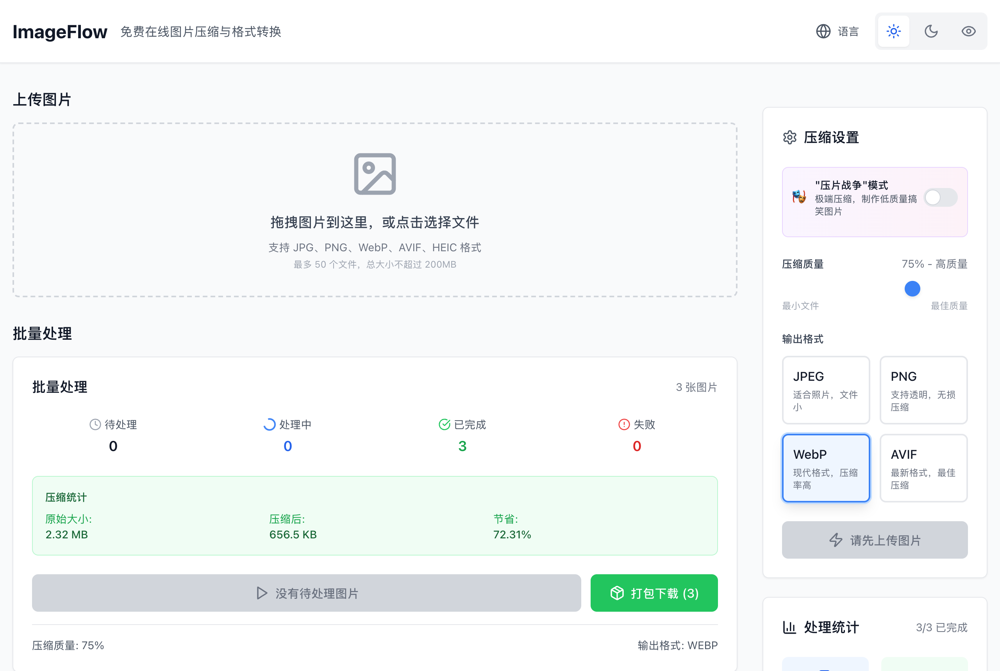

# ImageFlow — 浏览器端批量图像压缩与格式转换工具

<p align="center">
  
  
  
  
  
</p>

<p align="center">
  
</p>

**ImageFlow** 是一款基于浏览器 Web Worker 与 `OffscreenCanvas` 的本地批量图像压缩与格式转换应用。常规 JPEG、PNG、WebP 压缩流程完全在浏览器本地异步线程中完成，无需将原始图片上传至远端服务器；针对部分浏览器尚未原生支持编码的 AVIF 格式，提供可选的 Node.js / Express 服务端转换降级接口。

---

## 界面预览

<table>
  <tr>
    <td width="50%" align="center">
      
      <br />
      <sub><b>批量处理工作台</b>：拖拽上传、质量/格式参数调节、总体体积节省统计与 ZIP 打包导出</sub>
    </td>
    <td width="50%" align="center">
      
      <br />
      <sub><b>单图对比与统计图表</b>：原图/压缩图双栏预览、单文件压缩率明细与 Chart.js 统计视图</sub>
    </td>
  </tr>
</table>

---

## 核心功能

- **Web Worker 本地并行处理**：通过 `public/workers/imageProcessor.js` 在独立工作线程中调用 `OffscreenCanvas` 与 `createImageBitmap` 执行重采样和重编码，避免批量大图阻塞主线程 UI。
- **多格式互转与质量分级**：支持输出 `WebP`、`JPEG`、`PNG` 与 `AVIF` 四种格式，提供 10%–100% 连续质量滑块，以及极端低码率包浆效果（Meme Mode，5%–15% 质量叠加降采样）。
- **实时预览与 ZIP 批量归档**：点击任意图片卡片即可触发单图实时重编码对比，支持单张独立下载或通过 `JSZip` 将全部已完成图片一键打包为 `.zip` 归档。
- **多语言与主题切换**：内置 `i18next` 中英双语切换与浅色/深色/护眼主题（`src/contexts/ThemeContext.tsx`）。

---

## 技术栈与目录结构

| 模块 | 技术选型 | 说明 |
| :--- | :--- | :--- |
| 前端框架 | React 18.3 + TypeScript 5.8 + Vite 6 | 响应式单页应用，集成 `react-dropzone` 拖拽上传 |
| 图像处理内核 | Web Workers + `OffscreenCanvas` + `JSZip` | 浏览器端异步图像编解码与本地 ZIP 归档 |
| 可视化与样式 | Tailwind CSS 3.4 + Chart.js (`react-chartjs-2`) | 压缩率分布统计图表与多主题适配 |
| 可选服务端 | Express 4 (`api/`) | 供不支持客户端 AVIF 编码的环境执行服务端转换 |

```text
image-flow/
├── api/                     # 可选 Express 服务端（AVIF 转换与健康检查路由）
├── public/
│   └── workers/
│       └── imageProcessor.js # 浏览器端 OffscreenCanvas 图像压缩 Worker
├── src/
│   ├── components/
│   │   ├── BatchProcessor.tsx   # 批量队列进度、总体节省率与 ZIP 打包下载
│   │   ├── CompressionPanel.tsx # 质量滑块、目标格式与 Meme 模式控制面板
│   │   ├── DropZone.tsx         # 拖拽上传与文件大小/格式校验
│   │   ├── ImageList.tsx        # 懒加载缩略图卡片列表与单图下载
│   │   ├── ImagePreview.tsx     # 原图与压缩后图像双栏对比视图
│   │   └── StatisticsPanel.tsx  # 压缩前后体积对比统计面板
│   ├── contexts/            # 主题状态上下文
│   ├── hooks/               # Web Worker 生命周期与队列调度 (useImageProcessor)
│   ├── i18n/                # 中英文国际化词典
│   └── pages/               # 主工作台页面 (Home.tsx)
└── Dockerfile               # 容器化构建配置
```

---

## 快速开始

### 1. 安装依赖

```bash
git clone https://github.com/Evan-Joseph/image-flow.git
cd image-flow
pnpm install
```

### 2. 启动开发环境

仅启动前端工作台（推荐，默认使用浏览器本地 Worker 处理）：

```bash
pnpm run client:dev
```

同时启动前端与可选 Express 服务端：

```bash
pnpm run dev
```

### 3. 构建生产版本

```bash
pnpm run build
pnpm run preview
```

---

## 许可证

本项目基于 [MIT License](LICENSE) 开源。
