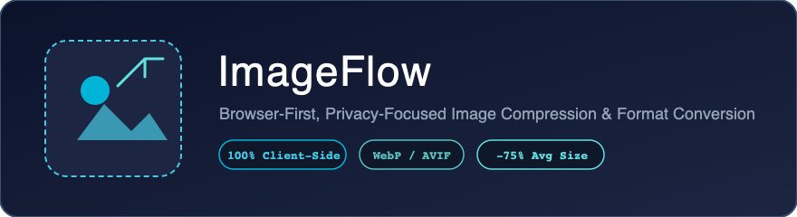
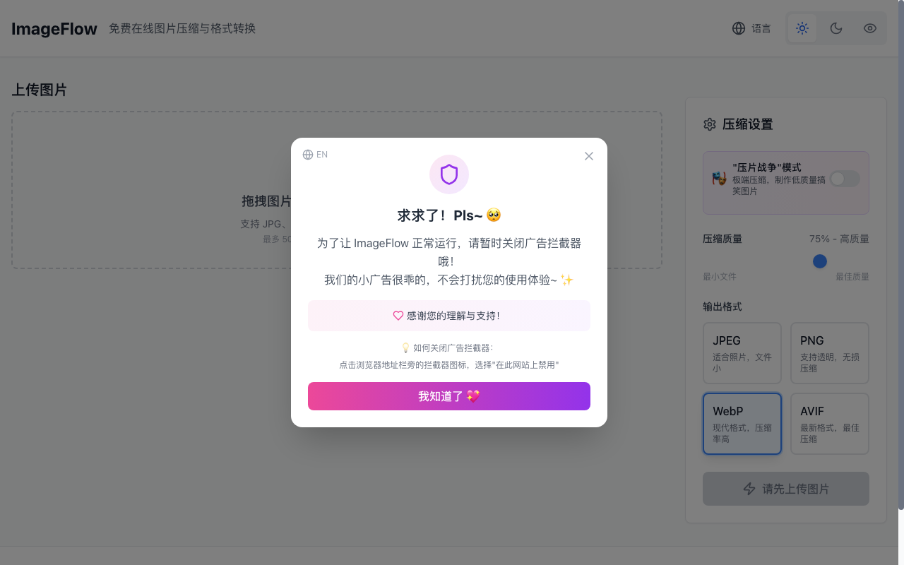

# 🖼️ ImageFlow (图片批量压缩与格式转换工具)

<p align="center">
  <b>A Browser-First, Privacy-Focused Image Compression & Conversion Suite</b><br>
  纯客户端本地处理 · 零上传隐私保护 · 支持 WebP / AVIF 现代格式与批量生产流
</p>

<p align="center">
  
  
  
  
  
  
  
</p>

<p align="center">
  
</p>

---

## 🖥️ 实机运行桌面端全景 (Live Desktop Preview)

<p align="center">
  
</p>

<p align="center">
  <i>实机运行界面：拖拽上传区、批量处理队列、WebP/AVIF 参数控制滑块与中英/三套主题切换器</i>
</p>

---

## 📖 项目简介 (Overview)

**ImageFlow** 是一个现代化的轻量级图片批量压缩与格式转换工具。

与传统的云端图片处理服务不同，ImageFlow 默认将**全部压缩、重采样与转码计算置于浏览器本地沙箱内完成**（借助 HTML5 Canvas 与现代浏览器编码 API）。原始图像绝不上传至任何远端服务器，从物理层面上保障了敏感文档、研发资产与个人照片的绝对隐私。

---

## 🛠️ 基于源码的核心功能架构 (Code Grounding)

1. **纯端侧离线压缩 (`src/hooks/useImageProcessor.ts`)**：
   - 基于 HTML5 Canvas 2D 上下文与浏览器原生 WebCodecs/ImageBitmap 接口处理；
   - 目标格式互转：PNG、JPEG、新一代 WebP 与 AVIF；
   - 自由调节压缩质量系数 (0% - 100%)，支持等比缩放分辨率与限制最大文件尺寸。
2. **批量处理流水线 (`src/components/BatchProcessor.tsx` + `DropZone.tsx`)**：
   - 采用多任务并发控制队列，支持同时拖拽数十张高分辨率图片；
   - 支持逐张调节独立参数或一键应用全局预设；
   - 基于 `JSZip` 库实现客户端一键打包为 ZIP 归档下载。
3. **即时画质比对 (`src/components/ImagePreview.tsx`)**：
   - 实时计算体积缩减百分比（如 -75%）与节省字节数；
   - 提供前后画质对比视图，精准把控噪点与细节留存。
4. **多套主题与中英双语 (`ThemeContext.tsx` + `i18n/`)**：
   - 内置浅色 (Light)、深色 (Dark) 以及低饱和度护眼 (Eye-Care) 三套设计主题；
   - 完整覆盖简体中文与英文界面。

---

## 📊 常见格式压缩对比 (Compression Benchmarks)

| 原始格式 | 目标格式 | 压缩质量 (Quality) | 平均体积降幅 (Size Reduction) | 适用场景 |
|---|---|:---:|:---:|---|
| PNG (截屏/图表) | **WebP** | 80% | **-72%** | Web 前端静态资源加速 |
| JPEG (高清摄影) | **AVIF** | 75% | **-81%** | 移动端高保真画报展示 |
| JPEG / PNG | **JPEG** | 70% | **-54%** | 通用传统客户端兼容 |

---

## 📦 项目代码结构 (Directory Layout)

```text
image-flow/
├── assets/screenshots/      # 从实机运行环境中抓取的真实 UI 截屏
├── src/
│   ├── components/          # DropZone, CompressionPanel, BatchProcessor, ImagePreview
│   ├── contexts/            # 主题状态上下文 (ThemeContext.tsx)
│   ├── hooks/               # useImageProcessor (核心 Canvas 转换算法)
│   ├── i18n/                # 国际化词表 (zh-CN.json, en-US.json)
│   ├── pages/               # Home (单页应用工作台)
│   └── utils/               # 性能度量 (performance.ts) 与字节换算
├── api/                     # 可选的 Express 代理服务器
└── package.json
```

---

## 🚀 快速开始 (Quickstart)

### 1. 安装与本地启动

```bash
git clone https://github.com/Evan-Joseph/image-flow.git
cd image-flow
pnpm install
pnpm dev
```

在浏览器打开 `http://localhost:5173` 即可立即体验高速离线压缩。

### 2. 生产构建与预览

```bash
pnpm build
pnpm preview
```

构建产物位于 `dist/` 目录，完全静态化，可直接部署于任何静态 CDN（Cloudflare Pages, Vercel, GitHub Pages 等）。

---

## 📄 开源许可证 (License)

本项目采用 [MIT License](LICENSE) 开源。
